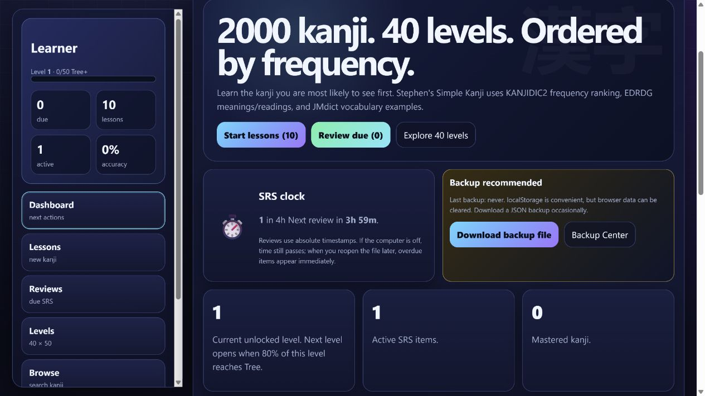
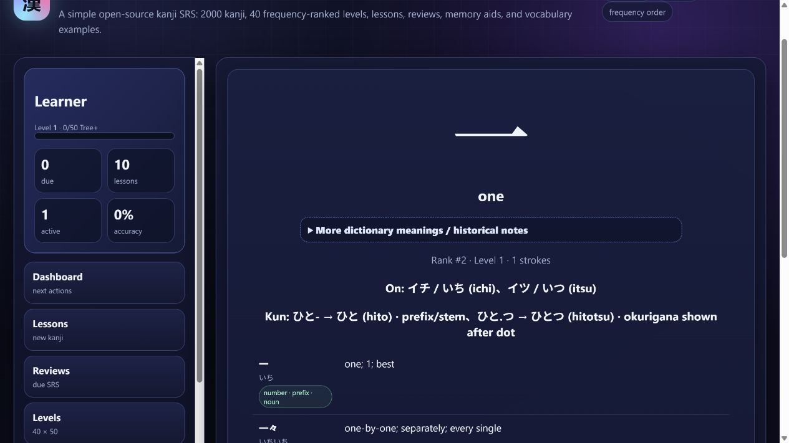

# Stephen's Simple Kanji

A free, private, offline-first SRS for learning 2,000 frequency-ranked Japanese kanji in 40 levels.

No account, server, subscription, or build step is required to use the app. Download `index.html`, open it in a modern browser, and start studying.



## Why this kanji SRS?

Stephen's Simple Kanji teaches characters in KANJIDIC2 newspaper-frequency order. It concentrates early study on kanji learners are more likely to encounter while reading.

The application includes:

- 2,000 kanji split into 40 levels of 50
- meaning and reading lessons
- browser-based SRS scheduling
- kana, katakana, and forgiving romaji input
- beginner-focused meanings with expandable dictionary notes
- vocabulary examples derived from JMdict
- clearly marked reading restrictions and okurigana
- data-grounded memory aids and private personal notes
- seven-day review forecasting
- a 28-day study activity calendar
- weak-item detection
- JSON backup, import, and level-jump recovery
- per-kanji content-report details



## Use it

Download or clone the repository and open `index.html`, or use the hosted app at **https://slmjr.github.io/Stephens-simple-kanji/**.

The repository URL in `src/data/metadata.json` lets in-app content reports open a prefilled GitHub issue.

Browser storage is scoped to the exact site origin. Moving between a local file, a GitHub Pages URL, and a custom domain creates separate storage locations. Export a backup before changing URLs.

Some browsers block persistent storage for directly opened `file://` pages. The app now falls back to session-only mode instead of trapping the learner on onboarding, and displays a warning when progress will not survive closing the tab. The published GitHub Pages version is recommended for persistent use.

## Privacy and backups

Progress stays in the browser's `localStorage`. The app has no account and sends no study data to a server.

Stored locally:

- display name and current level
- lesson and SRS state
- due dates and accuracy counts
- study activity totals
- personal memory aids and accepted meanings
- settings and backup metadata

Browser data can disappear after clearing site data, using private browsing, switching browsers or devices, or changing the hosted URL. Download backup JSON files regularly.

## Memory-aid policy

Version 1.1 removed the original generated mnemonic corpus. Built-in aids now use displayed meanings, listed readings, and real bundled vocabulary. Visual imagination is explicitly labelled as a memory cue rather than historical etymology.

See [Memory-aid guidelines](docs/MEMORY_AIDS.md). Learners can also save a personal memory aid for every kanji.

## Development

The public app remains one self-contained file, but its maintainable source is separated:

```text
src/index.template.html   page structure and metadata
src/styles.css            application styles
src/app.js                SRS and interface logic
src/data/kanji.json       embedded KANJIDIC2/JMdict-derived data
src/data/metadata.json    data version and repository URL
scripts/build.mjs         single-file build
scripts/check.mjs         data and build checks
```

Build and verify with Node.js 22 or newer:

```bash
npm run build
npm test
```

Commit the regenerated `index.html` with source changes. GitHub Actions checks that the generated file is current.

## Content corrections

Accuracy matters. Open a kanji in the app and select **Report content problem** for a prefilled report containing its ID, rank, readings, meanings, and data version.

Reports about readings, meanings, vocabulary, part-of-speech labels, or memory aids are welcome. Reliable dictionary or etymology sources are especially helpful.

## Data and attribution

Kanji and dictionary-derived fields are based in part on KANJIDIC2 and JMdict from the Electronic Dictionary Research and Development Group (EDRDG), used under Creative Commons Attribution-ShareAlike 4.0 International.

The project adds its own frequency-level ordering, SRS labels, UI, memory-aid system, display filters, and learning flow.

See [NOTICE.md](NOTICE.md) and [DATA_LICENSE.md](DATA_LICENSE.md).

## Donations

Every feature remains free. Optional donations support maintenance and content corrections.

- [Ko-fi](https://ko-fi.com/smjp53096)
- Additional cryptocurrency options are available inside the app's Data page.

## License

Original application code, UI, SRS logic, memory-aid system, and project documentation are provided under the MIT License. Embedded dictionary-derived data remains subject to EDRDG/CC BY-SA 4.0. See [LICENSE](LICENSE), [NOTICE.md](NOTICE.md), and [DATA_LICENSE.md](DATA_LICENSE.md).
